# About the library

`roo_display` is a feature-rich, fast, and easy to use library intended for building 'smart home' and similar controllers with graphical UI and optionally touch control.

## ESP-IDF emulator coverage

The IDF-only SPI display smoke initializes an ILI9341 through ESP-IDF's SPI
master API and writes a pixel through the roo_testing driver shim. The matching
example initializes a display and draws a small rectangle without using Arduino
headers or libraries:

```sh
bazel test --config=roo_testing_idf_esp32 //:idf_spi_display_test
bazel build --config=roo_testing_idf_esp32 //examples/espidf/ili9341
```

## Highlights

* Text: anti-aliasing, kerning, zero-flicker, FreeType-style alignment, font metrics, UTF-8, formatting;
* Fonts: collection of Google Noto Sans, Serif, and Mono fonts in various styles (regular, bold, condensed, italic, combinations), and multiple sizes included. Extended alphabet. Font import tool available;
* Shapes: variety of basic and anti-aliased shapes including filled and stroked circles, round-rectangles, triangles, wedges, pies, trapezoids, lines, and arcs, with specified widths and rounded or flat endings;
* Offscreen: supports drawing to memory buffers, using a rich variety of color modes (ARGB 8888, RGBA 8888, RGB 888, ARGB 6666, ARGB 4444, RGB 565, Gray8, Gray4, GrayAlpha8, Alpha8, Alpha4, Indexed8, Indexed4, Indexed2, Indexed1);
* Images: JPEG, PNG; custom RLE-encoded as well as uncompressed PROGMEM-compatible image formats, supporting variety of color modes (same as above); image import tool available;
* Icons: includes a collection of over 34000 Google Material Icons, divided into 4 styles, 18 categories, and 4 sizes;
* Positioning: flexible alignment options, magnification / stretch, rotation;
* Clipping: clip rectangles, clip masks;
* Color: internal 32-bit ARGB; transparency, alpha-blending, alpha-compositing, 140 named HTML colors; multi-node color gradients: linear, radial, angular;
* Compositing: backgrounds, overlays (sprites), zero-flicker, memory-conservative Porter-Duff and blending modes;
* Touch: excellent quality drivers with noise filtering and smoothing; supports multi-touch on compliant devices;
* Extensibility: clean abstractions, including drawable objects, device drivers, fonts; supports arbitrary extensions (e.g. user-defined drawables, third-party drivers) as first-class entities;
* Excellent performance: highly optimized SPI transport, vectorized interfaces;
* Low footprint: memory-conscious implementation;
* Documentation: comprehensive [programming guide](doc/programming_guide.md);
* See also: a companion [roo_windows](https://github.com/dejwk/roo_windows) library for building complex touch-based UI applications with scroll, animation, etc.

## Compatibility

* Supported SPI display drivers: GC9A01A, ILI9341, ILI9486, ILI9488, SSD1327, ST7735, ST7789, ST7796s;
* ESP32S3 DMA parallel driver harness;
* Adapter driver for TFT_eSPI-supported displays;
* Supported touch drivers: XPT2046, FT6x36, GT911;
* Supported integrated devices (microcontroller + touch display): LilyGo T-Display-S3, Makerfabs: 3.5in, 4.3in, 5in, and 7in, ILI9488 SPI-based capacitive touch combo; 4.3in, parallel DMA-based capacitive touch combo.

## Gallery

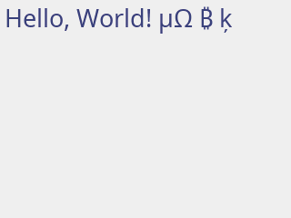
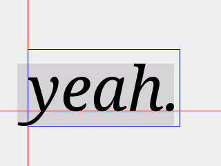
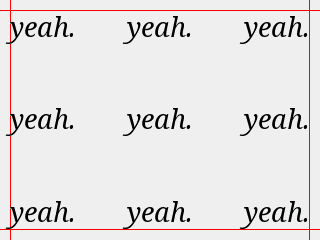
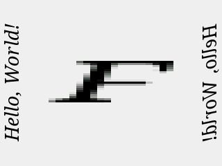
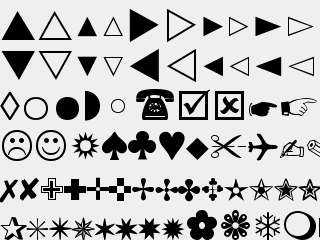
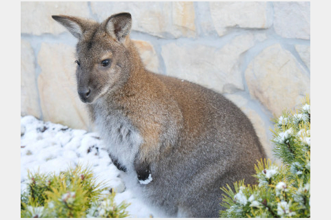
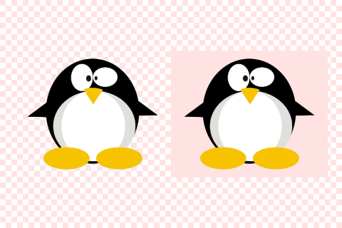
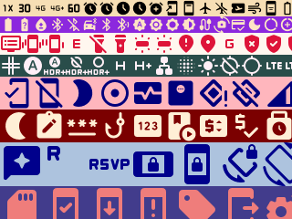


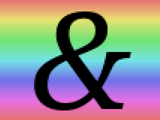


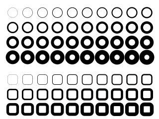
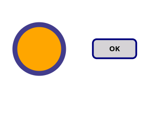
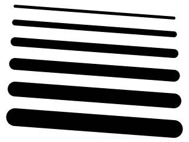
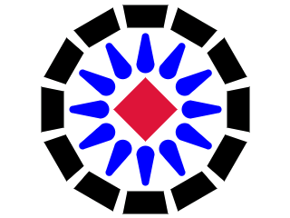
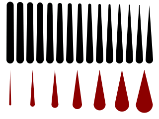
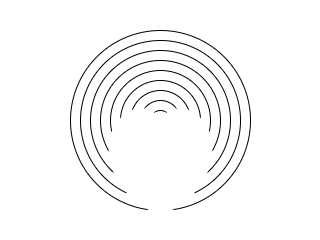
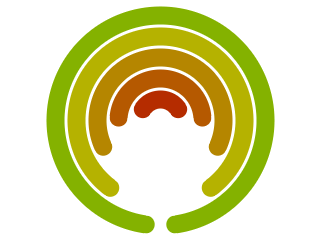
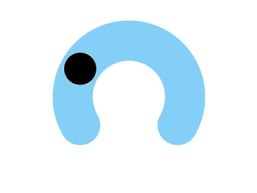
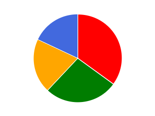
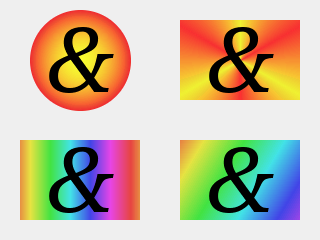

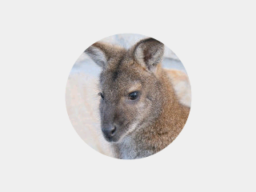
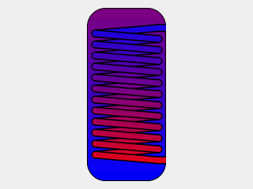
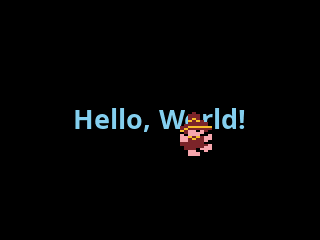
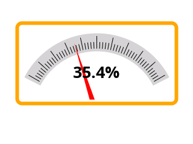

## User documentation

* [Programming guide](doc/programming_guide.md).
* [Quick start for TFT_eSPI](doc/for_tft_espi_users.md) users.

## Host emulation

Host builds support both Arduino and ESP-IDF through roo_testing 2.0. With
Bazelisk 1.21 or newer, a plain command defaults to Arduino and prints a notice:

    bazel test ...
    bazel test ... --config=asan
    bazel test ... --config=roo_testing_arduino_esp32
    bazel test ... --config=roo_testing_idf_esp32
    .roo_testing/bin/test_all_profiles ...

The files under .roo_testing are vendored from roo_testing; follow their
canonical-source headers when refreshing them.

Arduino examples are native runnable targets in their source packages. For
example:

    bazel run //examples/programming_guide/part1_1_basic_setup:part1_1_basic_setup

### I2C transport

I2C touch drivers use `roo_io/i2c/i2c.h` (`@roo_io//:i2c` in Bazel).
The existing `roo_display/hal/i2c.h` and backend headers retain type aliases for
source compatibility. Native IDF device registrations are released when their
drivers are destroyed; keep externally owned buses alive until then. See the
`roo_io` I2C documentation for bus initialization and ownership.

### XPT2046 SPI transport

The standard `TouchXpt2046<pinCS>` driver uses `roo_io` scoped SPI transactions
at 2.5 MHz, MSB first, mode 0. Existing default and explicit `Spi` constructors
remain available; the application initializes/owns the bus. `initTouch()`
configures the device and CS without reinitializing that bus. Native IDF borrows
the host used by the supplied display SPI object, so display and touch can share
one bus with separate CS pins. Destroy devices before deinitializing the bus.

Each hardware read holds one reservation/CS assertion through batched pressure
and coordinate exchanges and the final PENIRQ restore command. ADC words are
explicitly big-endian. Invalid ADC data or transport failures reject the sample;
PENIRQ cleanup is attempted and the scope always releases CS/the bus. Pressure
settling has a finite budget. `BasicTouchDevice` keeps its existing smoothing,
sampling interval, and short lost-contact inertia for the public `getTouch()` API.

Failed setup disables hardware reads. Call `initTouch()` again after correcting
bus setup to retry. Standard SPI wrappers expose `busHandle()` as a borrowed
`roo_io` view; custom SPI/GPIO policy types retain their legacy transaction path.
Their existing byte-transfer API cannot report transport failure. Pixel drivers
continue using their existing optimized transports.

Bazel clients need the `@roo_io//:spi` implementation (included by `:roo_display`).
Native firmware builds compile its SPI source and include `esp_driver_spi` and
`esp_driver_gpio`. Until the scoped API is released, pass local overrides:

```sh
bazel test //:touch_xpt2046_test --override_module=roo_io=../roo_io \
  --override_module=roo_testing=../roo_testing
bazel test --config=roo_testing_idf_esp32 //:touch_xpt2046_test \
  --override_module=roo_io=../roo_io --override_module=roo_testing=../roo_testing
```

The touch test checks coordinates/pressure, CS framing and PENIRQ cleanup,
invalid data, every native transfer-failure position, initialization retry,
custom policy compatibility, and alternating ILI9341/touch traffic on one bus.

### Pico host transport subset

The `:arduino_spi` target exposes the synchronous Arduino SPI transport on the
original Pico's native roo_testing profile. It uses Pico's set-pin and transfer
APIs while retaining the ESP32 transport path. `:pico_spi_transport_test` draws
a headless frame through the shared ST77xx model, checking bulk/fill byte order
and const input preservation. Use coordinated local roo_testing, roo_threads
and roo_time overrides until their releases are available.

This target covers the transport subset. The full library's filesystem,
ESP32-specific graphics paths and thread-dependent touch/reset drivers have
not been validated on the bare-metal Pico emulator. Pico SDK-only display
clients and physical board behavior are outside this transport test.

The `:touch_xpt2046` Bazel target exposes the touch driver and shared SPI
transport independently of the full display implementation. It supports ESP32,
ESP32-S3 and ESP32-C3 under Arduino/ESP-IDF, plus Arduino-Pico bare-metal and
FreeRTOS. Initialize the SPI controller/pins in the application and keep the bus
alive until the touch driver is destroyed. `:xpt2046_transport_test` exercises
real sampling, coordinates, one-CS framing and PENIRQ cleanup through the chip
fake on those profiles. SDK-only Pico display/touch HAL integration is separate.

The full `:roo_display` native aggregate is qualified on classic ESP32;
other emulated SoCs use the focused transport targets above. Firmware builds
continue to compile their platform-specific implementations directly from src.
